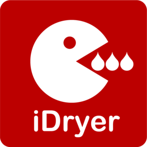
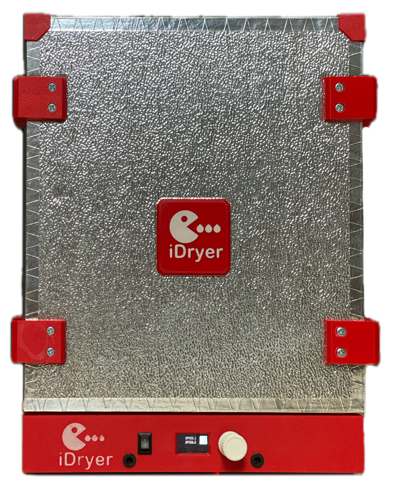
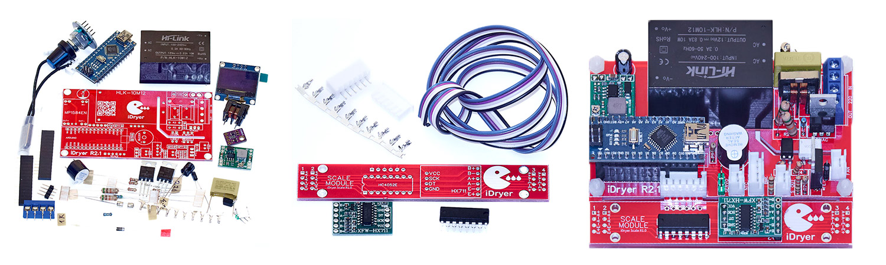

# iDryer X

**Everything you can expect from a filament dryer.**
Built by a 3D printer user, for 3D printer users.

   

---

## What this is

A filament dryer you build yourself. This repository holds everything you need for that: documentation, CAD models, files for CNC milling and laser cutting, and cutting layouts in PDF.

There is no single way to build an iDryer X. One spool or ten, different enclosures, different heaters, different ways to arrange convection. The principle stays the same: the dryer works equally well with every type of filament, never overheats it, and keeps it ready to print.

> **The documentation is the primary source of information: [docs.idryer.org](https://docs.idryer.org/en/projects/idryer/x/).** This repository is the reference base behind it: files, models and materials.

## The problem it solves

Filament picks up moisture from the air, and a part printed from wet material comes out worse than it should. A consumer filament dryer applies heat, but it gives you no accuracy, no repeatability, and no insight into what is happening inside.

iDryer X dries to a defined program, holds the temperature, tracks humidity, and switches to storage mode on its own when the cycle ends. It does this on about 40 W, less than a light bulb.

## Why the filament does not overheat

The enclosure is built from PIR panels. PIR has one of the lowest thermal conductivities of any insulation, and it releases no harmful substances when heated.

That single fact drives everything else. A well insulated chamber loses almost no heat, so the heater never has to force heat into the chamber. The difference between heater temperature and chamber air temperature stays within 5-10 °C, and the air leaving the heater is only two or three degrees above the setpoint.

The filament never meets a hot stream anywhere: not on the windings facing the heater, not in the core of the spool. For PLA and PETG, which start to misbehave near the glass transition temperature, that is the difference between drying a spool and ruining it.

The same insulation lets the dryer reach **110 °C** with confidence, which covers any engineering filament, including PA, PC and PPS.

## Who it is for

This project is for people willing to spend time on the documentation and build the dryer with their own hands. A dryer built that way lasts, and dries consistently.

You choose the entry point. Take the ready KIT and follow the instructions. Or build the whole thing from what you have on the shelf: an old hotend heater, a spare fan with a heatsink, a box from the hardware store, and some insulation. The parts list is limited only by your imagination.

## Status: v3 is current

The series has been developing for several years, and versions are numbered: the higher the number, the newer. **v3** is current.

- The documentation is complete enough to build from.
- Files for your own milling and laser cutting are included.
- KIT parts are manufactured industrially.
- The electronics are open, and the [PCB project](https://oshwlab.com/svet_team/idryer_copy_copy) is available in full.

→ [v3 overview](https://docs.idryer.org/en/projects/idryer/x/v3/overview/)

Earlier versions remain in the documentation. They work, and people still build them.

## KIT or from scratch

**KIT** is a ready set for self-assembly: milled PIR enclosure panels with slot joints, metal floor and spool holder parts, the PCB, electronics, sensors, fasteners, aluminium tape, and door sealing. All components are through-hole and large, so soldering is manageable even for a beginner.

→ [What is in the KIT](https://docs.idryer.org/en/projects/idryer/x/v3/kit/) · [Buy](https://store.idryer.org/)

**On your own** means the same drawings and files, built from whatever materials you can source. Everything you need for that is in the documentation and in this repository.

→ [Bill of materials](https://docs.idryer.org/en/projects/idryer/x/v3/bom/) · [Where to start](https://docs.idryer.org/en/projects/idryer/x/v3/before/)

## Features

**Drying.** Set the temperature and the time. The dryer reaches the setpoint and holds it accurately. Humidity is shown on the display. When the cycle ends, it switches to storage by itself.

**Storage.** Maintains a target humidity: heating and convection turn on when humidity rises above the limit. There is no time limit.

**Presets** for commonly used filaments, each with its own temperature and time.

**Scales.** Weigh the spool, set the tare weight, set the filament-low threshold, and pick the alert: buzzer or trigger output.

**A servo-driven damper** vents the chamber, with configurable open and closed intervals.

**Temperature** up to 110 °C, with separate control of the heater and of the chamber air. Drying time is unlimited.

**Power draw** is about 40 W while drying, 20 W in storage, and 3 W idle.

## Controller

The X series moved to a new platform.

**[iDryerControllerV2](https://github.com/pavluchenkor/iDryerControllerV2)** is the current option. A factory-made PCB, no hand assembly required, with connectors sized for the peripherals you need. Add the [iDryer Link](https://github.com/pavluchenkor/iDryer-Link) module to get the portal and the mobile app.

**[iDryerController](https://github.com/pavluchenkor/iDryerController)** is the previous platform. It is still supported, mostly by the community. v3 works with both.

## Place in the ecosystem

| Layer | What it does | Where |
|---|---|---|
| Dryer | Enclosure, mechanics, drawings — **this repository** | iDryer X |
| Controller | Firmware and control board | [iDryerControllerV2](https://github.com/pavluchenkor/iDryerControllerV2) |
| Connectivity | Wi-Fi, portal, app | [iDryer Link](https://github.com/pavluchenkor/iDryer-Link) |
| Other dryer | Modular, up to four chambers | [iDryer Unit](https://github.com/pavluchenkor/iDryer-Unit) |
| Cloud | Portal, app, integrations | [portal.idryer.org](https://portal.idryer.org/) |

## Difficulty and cost

| | |
|---|---|
| Soldering | required, components are through-hole and large |
| Making the parts | milling and laser cutting, or the ready KIT |
| **Dangerous voltage** | **yes, mains power is present in the circuit** |
| Skills | assembly from documentation, working with electrics |
| Time | depends on the route: from the KIT to a fully self-made build |

> **This is an electric heating appliance.** Never leave the device running unattended.

## What is in this repository

| Path | What it is |
|---|---|
| `CAD/` | Models, drawings and files for making the parts |
| `PDF/` | Cutting layouts and additional materials |

## License

CAD models, drawings and materials: [GNU GPL v3.0 or later](LICENSE).

Controller firmware is licensed separately, in its own repositories.

The iDryer name is not covered by this license, see [TRADEMARKS.md](https://github.com/pavluchenkor/idryer-core/blob/main/TRADEMARKS.md).

## Help

- [Telegram](https://t.me/iDryer)
- [Discord](https://discord.gg/jGce5eeHHz)
- [Documentation](https://docs.idryer.org/en/projects/idryer/x/)

The build and the contents of the KIT are covered on video: [YouTube](https://www.youtube.com/@iDryerProject) · [Rutube](https://rutube.ru/channel/34401569/)

## Contributing

If you built your own enclosure variant, improved the design, or found an error in a drawing, open an issue or send a pull request.

## Next

[Start here](https://docs.idryer.org/en/projects/idryer/x/v3/before/): what to decide and what to prepare before ordering parts.
